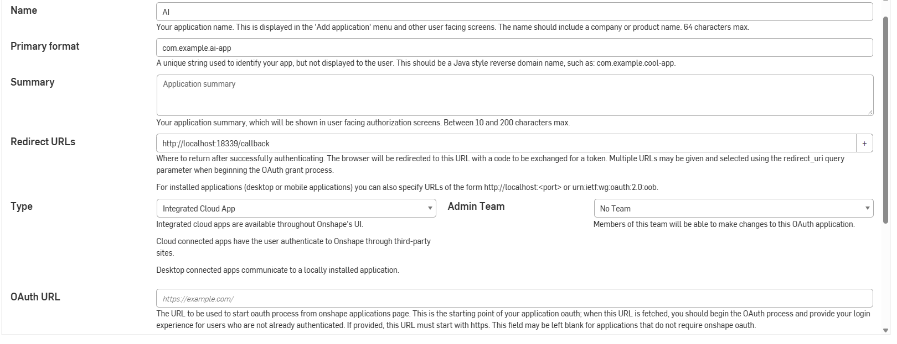
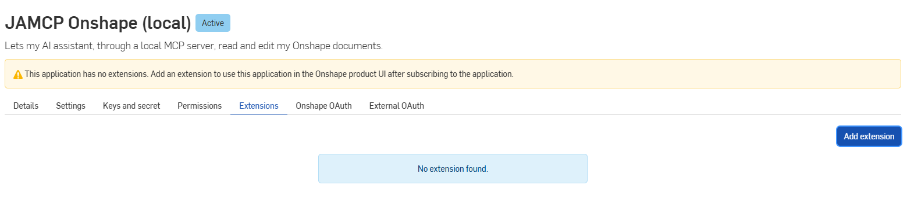

# OAuth sign-in (instead of API keys)

By default the server uses **API keys** (see [getting started](getting-started.md)). If you would
rather sign in with your Onshape account, it also speaks **OAuth 2**: you approve the application in
your browser once, and the server then works with short-lived access tokens that it renews by itself.

> **Status.** Checked live on 2026-11-16 against a real Onshape OAuth application: sign-in, API
> calls with the token, early refresh and the retry after a rejected token all worked (details in
> [development](development.md#verification-status-read-this-before-trusting-a-tool)). If
> something fails for you, [troubleshooting](troubleshooting.md#oauth) lists what to look at, and
> API keys keep working meanwhile.

## Which one should I use?

| | API keys (default) | OAuth |
|---|---|---|
| Setup | create a key, paste two values | register an application, paste two values, run `auth login` once |
| What sits in your client config | access key + **secret key that never expires** until you revoke it | client ID + client secret of **your** application; the sign-in itself is a token file |
| Token life | none (every request is signed) | access token about 60 minutes, renewed automatically |
| Revoking | delete the key in the developer portal | remove the application's access in Onshape, or delete the token file |
| Works for | everything | everything (same REST API) |

OAuth is not "more secure by magic": you still keep a client secret in the config, and the refresh
token is stored on disk. It suits you if you prefer revocable, expiring tokens or an app-based
grant over a permanent personal key. Onshape's own guidance is that automation scripts may use
either.

## Set it up

**1. Register your own OAuth application** in Onshape's developer portal and note its client ID
and client secret. The form, field by field, is in
[Creating the OAuth application in Onshape](#creating-the-oauth-application-in-onshape) below; the
one value that must be exact is the redirect URL, `http://localhost:18339/callback`. The secret
cannot be bundled with this package, which is why every user registers an application of their own.

**2. Put the two values in your MCP client's `env`** instead of the API keys:

```json
"env": {
  "ONSHAPE_OAUTH_CLIENT_ID": "your-client-id",
  "ONSHAPE_OAUTH_CLIENT_SECRET": "your-client-secret"
}
```

With only these set (no API keys) the server switches to OAuth on its own. If API keys are set as
well, they win; add `"ONSHAPE_AUTH_MODE": "oauth"` to use OAuth anyway.

**3. Sign in once** from a terminal, with the same two variables in that terminal's environment:

```bash
# bash / zsh
ONSHAPE_OAUTH_CLIENT_ID=... ONSHAPE_OAUTH_CLIENT_SECRET=... uvx onshape-jamcp auth login
```

```powershell
# PowerShell
$env:ONSHAPE_OAUTH_CLIENT_ID = "..."; $env:ONSHAPE_OAUTH_CLIENT_SECRET = "..."
uvx onshape-jamcp auth login
```

Your browser opens Onshape's consent page; after you approve, the terminal says `Signed in`. On a
machine without a browser use `auth login --no-browser`, open the printed URL yourself, and finish
on that same machine (the redirect goes to `localhost`).

**4. Restart the MCP client** and ask it to run `whoami`: it should name your account.

## Creating the OAuth application in Onshape

Sign in at <https://dev-portal.onshape.com> and create a new OAuth application (Onshape describes
the concept on its [OAuth page](https://onshape-public.github.io/docs/auth/oauth); the portal's menu
names may change, the form below is what it asked for on 2026-11-16).



*The creation form. The **Name** and **Primary format** in this screenshot are placeholders to
replace; the **Redirect URLs** value is the right one.*

| Field | What Onshape says | What to enter |
|---|---|---|
| **Name** | Shown in the "Add application" menu and other user-facing screens; should include a company or product name; 64 characters max. | Something recognisable, because it is the name on the consent screen: `JAMCP Onshape MCP (local)`. |
| **Primary format** | A unique string that identifies the app and is never shown: a Java-style reverse domain name such as `com.example.cool-app`. | Your own unique value, e.g. `io.github.<your-github-name>.onshape-jamcp`. Do not keep the `com.example.*` placeholder. |
| **Summary** | Shown on the authorization screen; 10 to 200 characters. | One sentence, e.g. `Lets my AI assistant, through a local MCP server, read and edit my Onshape documents.` |
| **Redirect URLs** | Where the browser returns after sign-in, with the code. For installed (desktop or mobile) applications the form `http://localhost:<port>` is allowed. | `http://localhost:18339/callback`, character for character (scheme, host, port, path). One URL is enough: ignore the **+** button. A different port needs `ONSHAPE_OAUTH_PORT` set to the same number. |
| **Type** | *Integrated cloud* apps are available throughout Onshape's UI; *cloud connected* apps authenticate users through third-party sites; *desktop connected* apps communicate with a locally installed application. | **Desktop connected.** This server is a locally installed program. (The other two types were not tried.) |
| **Admin Team** | Members of this team can change the application. | `No Team`, unless a team should manage it. |
| **OAuth URL** | The URL Onshape calls to start an OAuth flow from its applications page; may be left blank for applications that do not need that. | **Leave it blank.** The sign-in here starts from your terminal (`auth login`). |

After you save, the application's page has these tabs:



*The application's page. The yellow notice about extensions can be ignored.*

- **Permissions**: tick what the assistant may do: read, write for the modeling tools, delete only
  if you want `delete_feature`. Onshape grants exactly these (the token reply lists them), and
  nothing is asked for in the sign-in request itself.
- **Keys and secret**: the **client ID** and **client secret** you put in
  `ONSHAPE_OAUTH_CLIENT_ID` / `ONSHAPE_OAUTH_CLIENT_SECRET` (step 2 above). Treat the secret like a
  password and do not paste it into chat or commit it; if it leaks, regenerate it there and run
  `auth login` again.
- **Extensions**: not needed. An extension places an application inside Onshape's own interface
  (a tab or menu entry); this server calls the REST API from outside.
- **Details**, **Settings**, **Onshape OAuth**, **External OAuth**: nothing to set for this server.
  (**Onshape OAuth** presumably holds the *OAuth URL* from the form; we left it empty.)

The first `auth login` then shows Onshape's consent page for your application. **Allow** finishes
the sign-in. **Deny** sends the browser back with `access_denied`; the command reports it and stores
nothing, so just run it again.

## Commands

| Command | What it does |
|---|---|
| `onshape-jamcp auth login` | Browser sign-in; stores the tokens. `--no-browser` only prints the URL. |
| `onshape-jamcp auth status` | Shows the configuration and whether you are signed in, and for how long the current access token is valid. Never prints a token. |
| `onshape-jamcp auth logout` | Deletes the stored tokens. |

With no subcommand the program is the MCP server, as before.

## Settings

| Variable | Default | |
|---|---|---|
| `ONSHAPE_OAUTH_CLIENT_ID` / `ONSHAPE_OAUTH_CLIENT_SECRET` | - | Your OAuth application. |
| `ONSHAPE_OAUTH_PORT` | `18339` | Port of the local sign-in callback; the redirect URL is `http://localhost:<port>/callback`. |
| `ONSHAPE_OAUTH_TOKEN_FILE` | per-user config folder | Where tokens are kept (`%APPDATA%\onshape-jamcp\oauth.json` on Windows, `~/.config/onshape-jamcp/oauth.json` elsewhere). |
| `ONSHAPE_OAUTH_URL` | `https://oauth.onshape.com` | Onshape's OAuth server. Only change it if your Onshape enterprise tells you to. |
| `ONSHAPE_AUTH_MODE` | automatic | `oauth` forces OAuth; `hmac` / `basic` force API keys. |

## How it behaves

- **Sign-in** uses the authorization-code flow. The server listens on `127.0.0.1` only (not on your
  network), checks the `state` value so a forged request is ignored, takes the one-time code and
  exchanges it for tokens. It gives up after five minutes.
- **Renewal.** Before a request, a token with less than 30 seconds left is renewed. If Onshape
  answers `401` anyway, the server renews once and repeats the request. Whatever Onshape returns
  is saved: its documentation says the refresh token is replaced on every renewal, but in a live
  check it stayed the same, and while the old access token was still valid Onshape handed the same
  one back with its true remaining lifetime. Both behaviors are handled.
- **Several servers, one account** share the token file; one that finds a newer pair there uses it
  instead of renewing with a refresh token that has already been replaced. (There is no cross-process
  lock, so two servers renewing in the same instant can still collide - then run `auth login` again.)
- **Tokens never leave `*.onshape.com`.** Like API keys, the bearer token is not sent to the
  third-party hosts Onshape sometimes redirects downloads to. It is never logged and never returned
  by a tool; `get_settings` only says whether you are signed in.
- **Where tokens live.** One small JSON file, replaced atomically. On Linux and macOS it is created
  readable by you only (mode 600). On Windows it sits in your user profile, which other accounts
  cannot read by default, but no extra permissions are set. Treat the file like a password: anyone
  who can read it can act as you until the grant is revoked.
- **Revoked or expired grant** (the refresh token stops working): requests fail with a message to run
  `auth login` again.

## What is not covered

- Hosting the server for several users (an HTTP transport with per-user sign-in). This is a local
  server that acts as one Onshape user.
- PKCE: Onshape's documentation does not describe it, so it is not sent (the login works without).
- A `scope` in the authorization request: not needed. Onshape grants the permissions ticked on the
  application's **Permissions** tab and reports them with the token (seen live:
  `OAuth2Read OAuth2Write OAuth2Delete OAuth2ReadPII OAuth2Share`). Untick what you do not need.
